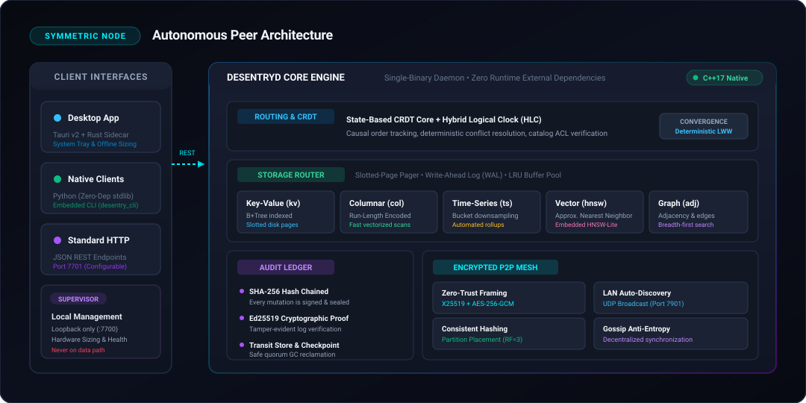
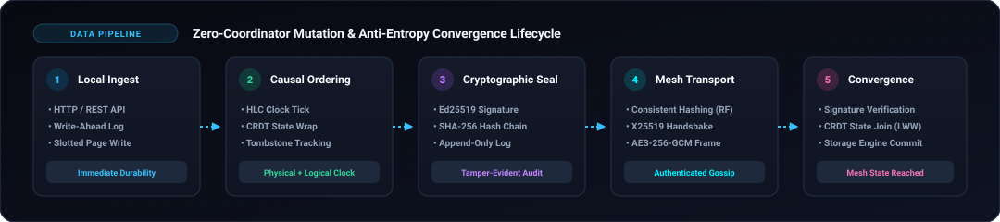

<p align="center">
  
</p>

<!-- CI rebuild trigger -->

<p align="center">
  <a href="https://github.com/R1sh1m/De-sentry/releases"></a>
  
  
  
  
  
  <a href="STATUS.md"></a>
</p>

---

# De-Sentry
### Enterprise-Grade Decentralized Embedded Database Engine

De-Sentry is a high-performance, decentralized peer-to-peer storage engine engineered in **C++17** from first principles. Designed for zero-trust, edge-first, and air-gapped environments, every node operates as an autonomous, symmetric peer integrating an embedded storage layer, a high-throughput HTTP/REST interface, and an encrypted P2P synchronization plane.

By eliminating coordinator-dependent consensus protocols in favor of state-based **Conflict-Free Replicated Data Types (CRDTs)** and **Hybrid Logical Clocks (HLC)**, De-Sentry achieves mathematically guaranteed eventual consistency without leader elections, network lock contention, or single points of failure.

<p align="center">
  <a href="#quickstart"><b>🚀 Quickstart Guide</b></a> &nbsp;•&nbsp;
  <a href="https://github.com/R1sh1m/De-sentry/releases"><b>📦 Download v1.1 App</b></a> &nbsp;•&nbsp;
  <a href="#system-architecture"><b>🏗️ System Architecture</b></a> &nbsp;•&nbsp;
  <a href="#documentation-hub"><b>📖 Full Documentation</b></a>
</p>

---

## Performance & Reliability at a Glance

| Metric | Target / Capability | Architecture Rationale |
|---|---|---|
| **0 ms** | **Leader Election Latency** | Multi-master CRDT replication with deterministic Last-Write-Wins (LWW) |
| **0** | **Runtime Dependencies** | Self-contained single-binary daemon; runs fully air-gapped |
| **5** | **Native Storage Engines** | Router handles Key-Value, Columnar, Time-Series Rollup, Vector (HNSW), Graph |
| **100%** | **Audit Verification** | Every mutation signed with Ed25519 in a SHA-256 hash-chained ledger |
| **14 / 14** | **Suites Passing** | Continuous assertions with `-UNDEBUG` across all optimized builds |

---

## Key Capabilities

- **Symmetric Peer Topology**: Eliminates centralized primaries and coordinator bottlenecks. Every node maintains identical read, write, and replication authority.
- **Deterministic Multi-Master Convergence**: Concurrent writes across network partitions resolve deterministically via state-based CRDTs and causal HLC ordering.
- **Cryptographic Auditability**: Every state transition appends to an Ed25519-signed, SHA-256 hash-chained tamper-evident audit ledger.
- **Zero-Trust Network Transport**: Node-to-node communications are encrypted and authenticated via X25519 key exchange and AES-256-GCM framing with automated UDP LAN discovery.
- **Autonomous & Air-Gapped**: Functions fully offline with zero external runtime dependencies; automatically reconciles state upon network reconvergence.
- **Pluggable Multi-Model Backends**: Integrated storage router featuring 5 native backends: Key-Value (B+Tree), Columnar (RLE), Time-Series Rollup, Vector (HNSW-Lite), and Graph Adjacency.

---

## System Architecture

<p align="center">
  
</p>

An out-of-band **Supervisor Plane** (`supervisor: true`, bound strictly to loopback `:7700`) manages local hardware profiling, process health, and automatic engine sizing without ever intercepting or participating in the data synchronization path.

---

## Data Mutation & Convergence Lifecycle

<p align="center">
  
</p>

---

## Architectural Comparison

| Dimension | Conventional Client/Server | Distributed Consensus (Raft/Paxos) | **De-Sentry Mesh** |
|---|---|---|---|
| **Topology** | Single Primary + Read Replicas | Elected Leader + Quorum Nodes | **Fully Symmetric Peer-to-Peer** |
| **Partition Write Behavior** | Writes rejected on primary outage | Rejected if partition loses quorum | **Always Accepted Locally** |
| **Concurrency Control** | Distributed 2PC / Pessimistic Locking | Leader-sequenced state logs | **Conflict-Free CRDT Convergence (LWW)** |
| **Audit & Integrity** | Proprietary replication logs | Unsigned distributed commit logs | **Ed25519-Signed SHA-256 Hash Ledger** |
| **Air-Gap / Edge Readiness** | Inoperable without server link | Inoperable under partitioned nodes | **Full Autonomous Read/Write Offline** |
| **Runtime Dependencies** | Server daemon + runtime libraries | Coordination cluster + dependencies | **Zero Runtime External Dependencies** |

---

## Quickstart

### 1. Desktop Management Plane
Pre-packaged native installers for Windows (`.msi`), macOS (`.dmg`), and Linux (`.AppImage` / `.deb`) are available under [Releases](https://github.com/R1sh1m/De-sentry/releases). The application bundles the daemon, Rust sidecar, system tray controls, and offline hardware-aware sizing models.

### 2. Local Headless Mesh (CLI)
Initialize and launch an isolated 3-node symmetric cluster in seconds:

```bash
# Launch 3-node cluster with supervisor plane (Linux/macOS)
./scripts/run_cluster.sh 3 --supervisor --engines kv,ts_rollup

# Execute write to node 1:
curl -s -X PUT http://127.0.0.1:7701/db/users/u1 -d '{"name":"Asha","role":"admin"}'

# Verify immediate converged state on peer node 2:
curl -s http://127.0.0.1:7702/db/users/u1

# Terminate mesh:
./scripts/stop_cluster.sh
```
*(Windows PowerShell: `.\scripts\run_cluster.ps1 -Nodes 3 -Supervisor` / `.\scripts\stop_cluster.ps1`)*

### 3. Native Python SDK
A lightweight client requiring only the Python standard library (`pip install` is zero-dependency):

```python
import sys; sys.path.insert(0, "clients/python")
from desentry_client import DesentryClient

# Connect to local peer node
client = DesentryClient("http://127.0.0.1:7701")
client.put("users", "u1", {"name": "Asha", "role": "admin"})

# Fetch document and verify cryptographic ledger integrity
doc = client.get("users", "u1")
audit = client.verify_ledger()
print(f"Verified: {audit['verified']} | State: {doc}")
```

---

## Documentation Hub

| Document | Focus & Scope |
|---|---|
| 📦 [**Building & Installation Guide**](docs/building.md) | Platform toolchains (GCC, Clang, MSVC), CMake build flags, and developer workflows |
| 🏗️ [**Architecture (v1 Engine Core)**](docs/architecture.md) | Slotted pages, Write-Ahead Log (WAL), buffer pool, CRDT joins, HLC, and gossip protocol |
| 🛡️ [**Architecture (v2 Router & Supervisors)**](docs/architecture-v2.md) | Pluggable storage router, out-of-band supervisor plane, ledger v2, and threat model |
| 🌐 [**REST API Reference**](docs/api.md) | Complete endpoint specifications for database CRUD, CRDT state, ledger, and supervisors |
| 🔧 [**Troubleshooting & FAQ**](docs/troubleshooting.md) | Verified error-to-fix diagnostic matrix across Windows, macOS, and Linux |
| 🔬 [**Academic Foundations & Literature**](docs/LITERATURE.md) | Theoretical foundations (Dynamo, ARIES, Lamport, Preguiça, HNSW) and design rationale |
| 🎨 [**Design System & UI Tokens**](DESIGN.md) | Desktop control plane specifications, typography, and visual design tokens |
| 🚦 [**Verification Status**](STATUS.md) | Verified multi-process test logs, platform ports, and release criteria |
| ⚠️ [**Release Acceptance & Known Issues**](ISSUES.md) | Release validation checklist, edge cases, and known limitations |

---

## Verification & Test Integrity

De-Sentry rejects synthetic mocking in favor of continuous real-world verification:
- **13 C++ Unit Test Suites**: Built with `-UNDEBUG` to preserve active assertions across optimized builds.
- **4 Multi-Process Integration Suites**: Real daemon orchestration testing network partitions, transient replays, air-gapped USB sync, and chaotic soak tests.
- **Cryptographic Ledger Auditing**: Continuous automated validation of SHA-256 hash chains and Ed25519 signatures.

For detailed test logs, see [`STATUS.md`](STATUS.md).
