<p align="center">
  
</p>

<!-- CI rebuild trigger -->

<p align="center">
  <a href="https://github.com/R1sh1m/De-sentry/releases"></a>
  
  
  
  
  <a href="STATUS.md"></a>
</p>

---

# 🔮 De-Sentry

> **The mesh is the artifact.** A decentralized, fully peer-to-peer database engine where every node is simultaneously a storage engine, a REST API server, and an encrypted P2P peer. No coordinators. No leaders. No single point of failure.

Built in **C++17** from first principles — the way real database engines are forged. A hand-written paged storage layer with WAL and disk-backed B+Tree (not a wrapper around SQLite or RocksDB), a **CRDT document model** for conflict-free multi-writer replication, and a from-scratch encrypted P2P transport. The only third-party dependency is **OpenSSL** for cryptographic primitives.

**v2** introduces an Apple-inspired **desktop control room** built with Tauri v2. It provisions nodes, supervises `desentryd` processes, executes offline semantic sizing, and keeps the mesh synchronized in the system tray. Everything works **offline-first** — verified by real airplane-mode integration suites.

---

## Why De-Sentry?

| Capability | Conventional Client/Server DB | Traditional Distributed DB | **De-Sentry** |
|---|---|---|---|
| **Topology** | Single primary; clients connect | Leader + followers / coordinators | Flat P2P mesh; every node is symmetric |
| **Writes during partition** | Unavailable or rejected | Quorum-dependent | Always accepted locally |
| **Conflict resolution** | Locking / MVCC on primary | Consensus (Raft / Paxos) | Mathematical CRDT convergence |
| **Coordinator / Leader** | Central server | Elected leader / coordinator | **None, by design** |
| **Offline operation** | None | Limited / read-only | Full read/write; syncs on reconnect |
| **Runtime dependencies** | Server daemon + drivers | Heavy distributed runtime | **Just OpenSSL** (zero fetched deps) |

- **No single point of failure**: Kill any peer node; the mesh continues reading and writing.
- **No lock contention across the network**: Concurrent writers converge mathematically via Hybrid Logical Clocks (HLC) and state-based CRDTs.
- **Auditable & tamper-evident**: Every mutation appends to an Ed25519-signed, SHA-256 hash-chained cryptographic ledger.
- **Air-gapped operation**: A laptop in airplane mode is a fully operational, independent database node.

---

## Architecture at a Glance

```
                 ┌─────────────────────────────────────────────────────────┐
                 │                   desentryd (Peer Node)                 │
                 │                                                         │
  Local Clients  │  ┌─────────────┐       ┌──────────────────────────────┐ │
  (HTTP / Curl / ───┼─▶│  REST API   │       │         Engine Core          │ │
   Python)       │  │  Port 7701  │◀─────▶│  (Router, CRDT, Catalog)     │ │
                 │  └─────────────┘       └──────────────┬───────────────┘ │
                 │                                       ▼                 │
                 │                        ┌──────────────────────────────┐ │
                 │                        │        Storage Engine        │ │
                 │                        │ Slotted Pages, WAL, B+Tree,  │ │
                 │                        │ Buffer Pool, Engine Backends │ │
                 │                        └──────────────────────────────┘ │
                 │                                       ▲                 │
                 │  ┌────────────────────────────────────┘                 │
                 │  ▼                                                      │
                 │ ┌─────────────────────────────────────────────────────┐ │
                 │ │                     P2P Mesh                        │ │
                 │ │ Ed25519/X25519 Auth · AES-256-GCM Secure Channel    │ │
                 │ │ UDP LAN Discovery · Consistent Hashing (RF=3)       │ │
                 │ │ Gossip Anti-Entropy Replicator · Transit Store      │ │
                 │ └─────────────────────────────────────────────────────┘ │
                 └───────────────────────────┬─────────────────────────────┘
                                             │ Encrypted P2P frames
                                             ▼
                                  Other Symmetric Mesh Peers
```

Above the data plane, an app-local **Supervisor plane** (`supervisor: true`, loopback-only) handles hardware discovery, storage layout sizing, and process supervision. **Supervisors are never on the data path.**

---

## Native Storage Engines

De-Sentry features a pluggable storage router with 5 zero-dependency native backends:

- **Key-Value (`kv`)**: B+Tree indexed persistent key-value store with slotted pages.
- **Columnar (`columnar`)**: Run-length encoded analytics store for high-throughput scans.
- **Time-Series (`ts_rollup`)**: Time-bucketed metric store with automatic downsampling rollups.
- **Vector (`vector_hnsw_lite`)**: In-memory and disk-backed HNSW approximate nearest neighbors.
- **Graph (`graph_adj`)**: Vertex adjacency and edge attribute store for graph traversals.

*Optional vendored engines (SQLite, DuckDB, LMDB, sqlite-vec) can be compiled from `third_party/` without network fetching. See [Building Guide](docs/building.md).*

---

## Quickstart

### 1. Desktop Control Room (Recommended)

Download the pre-bundled native installer for Windows (`.msi`), macOS (`.dmg`), or Linux (`.AppImage` / `.deb`) from [Releases](https://github.com/R1sh1m/De-sentry/releases). The installer bundles the engine, sidecar, and offline sizing model.

### 2. Automated One-Command Source Setup

Clone and run the automated setup script to verify dependencies, build the engine, and stage the sidecar:

```bash
# Linux / macOS
./scripts/setup.sh
```

```powershell
# Windows PowerShell
.\scripts\setup.ps1
```

### 3. Local Mesh (Headless Cluster)

Launch an isolated 3-node cluster with a supervisor in seconds:

```bash
# Launch 3 nodes (API: 7701-7703, P2P: 7801-7803)
./scripts/run_cluster.sh 3 --supervisor --engines kv,ts_rollup

# Write to node 1:
curl -s -X PUT http://127.0.0.1:7701/db/users/u1 -d '{"name":"Asha","role":"admin"}'

# Read converged state immediately from node 2:
curl -s http://127.0.0.1:7702/db/users/u1

# Stop cluster:
./scripts/stop_cluster.sh
```

*(Windows: `.\scripts\run_cluster.ps1 -Nodes 3 -Supervisor` / `.\scripts\stop_cluster.ps1`)*

### 4. Docker Compose

```bash
docker compose up --build               # Spin up 3 nodes + run integration tests
docker compose run tester               # Re-run integration test suite
```

### 5. Zero-Dependency Python Client

Python ≥ 3.8 standard library only (`pip install -r clients/python/requirements.txt` is an intentional no-op):

```python
import sys; sys.path.insert(0, "clients/python")
from desentry_client import DesentryClient

node = DesentryClient("http://127.0.0.1:7701")
node.put("users", "u1", {"name": "Asha", "role": "admin"})

doc = node.get("users", "u1")
print(doc)  # {'name': 'Asha', 'role': 'admin'}

print(node.verify_ledger())  # {'verified': True, 'entries_checked': ...}
```

---

## Documentation Hub

Detailed documentation is partitioned into focused reference guides:

| Document | Description |
|---|---|
| 📦 [**Building & Installation Guide**](docs/building.md) | Platform prerequisites (Ubuntu, macOS, Windows), manual builds, CMake flags, and dev shell |
| 🔧 [**Troubleshooting & FAQ**](docs/troubleshooting.md) | Comprehensive error-to-fix matrix (OpenSSL paths, MSVC linking, WebKit2GTK, ONNX, D-Bus) |
| 🌐 [**REST API Reference**](docs/api.md) | Complete specification for data plane, CRDT, ledger, transit store, and supervisor endpoints |
| 🏗️ [**Architecture (v1 Core)**](docs/architecture.md) | Deep dive on slotted pages, WAL, buffer pool, CRDT joins, HLC, and gossip protocol |
| 🛡️ [**Architecture (v2 Supervisors & Router)**](docs/architecture-v2.md) | Storage router, supervisor plane, ledger v2, ACL enforcement, and threat model |
| 🔬 [**Research Foundation & Literature**](docs/LITERATURE.md) | Academic foundations (Dynamo, ARIES, Lamport, Preguiça, HNSW) and design rationale |
| 🎨 [**Design System & UI Tokens**](DESIGN.md) | Apple-inspired UI design tokens, typography, surfaces, and control room specs |
| 🚦 [**Verification Status**](STATUS.md) | Verified test matrix, execution logs, and open platform ports |
| ⚠️ [**Known Issues & Acceptance**](ISSUES.md) | Release acceptance checklist, edge cases, and known limitations |

---

## Verification & Test Integrity

De-Sentry rejects synthetic or mocking-heavy test suites:
- **13 C++ unit suites** compile with `-UNDEBUG` so assertions remain live under release builds.
- **4 Multi-process integration suites** execute against real spawned `desentryd` daemons (`airplane_mode_test.py`, `transit_replay_test.py`, `usb_node_test.py`, `soak_test.py`).
- **Cryptographic ledger audit** verifies hash chains and Ed25519 signatures end-to-end.

See [`STATUS.md`](STATUS.md) for the verified test log.

---

## PowerShell Quoting

When using the De-Sentry CLI or REST API from PowerShell, you may encounter issues with JSON quoting due to PowerShell's different quote handling compared to bash.

### The Problem

PowerShell interprets quotes differently than bash. For example:

```powershell
# This may not work as expected in PowerShell:
curl -X PUT http://127.0.0.1:7701/db/users/u1 -d '{"name":"Asha"}'
```

### Workarounds

1. **Use the Python client** (recommended):
   ```powershell
   python -c "import sys; sys.path.insert(0, 'clients/python'); from desentry_client import DesentryClient; c = DesentryClient('http://127.0.0.1:7701'); c.put('users', 'u1', {'name': 'Asha'})"
   ```

2. **Use PowerShell's native Invoke-RestMethod**:
   ```powershell
   $body = @{ name = "Asha"; role = "admin" } | ConvertTo-Json
   Invoke-RestMethod -Uri "http://127.0.0.1:7701/db/users/u1" -Method PUT -Body $body -ContentType "application/json"
   ```

3. **Escape inner quotes** (for simple cases):
   ```powershell
   curl -X PUT http://127.0.0.1:7701/db/users/u1 -d '{\"name\":\"Asha\"}'
   ```

4. **Use double quotes with escaped variables**:
   ```powershell
   curl -X PUT http://127.0.0.1:7701/db/users/u1 -d "{`"name`":`"Asha`"}"
   ```

For complex JSON payloads, the Python client or `Invoke-RestMethod` are the most reliable approaches.
